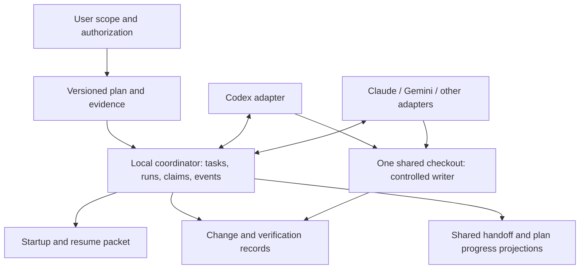

# Multi-harness project continuity — feasibility and engineering review

**Assessment date:** 2026-10-20, Asia/Calcutta. **Project:** F:/proj-fmea. **Published baseline:** v0.12.0, commit `6986f53c2b0e0a90ff69833e9967711bce213ccc`. **Artifact:** feasibility report, not an authorized implementation plan or a claim that the proposed coordinator is built.

## 1. Recommendation and feasibility verdict

Yes. Codex, Claude Code, Gemini, OpenCode, Cursor and other compatible harnesses can work against one project with durable shared knowledge of the plan, the previous worker's changes, incomplete work and the next task. The reliable common interface is an explicit project coordination protocol, not access to each other's private chat histories.

The present repository has a useful document-driven foundation and successful manual continuity practices. It does **not** yet provide dependable automatic cross-harness execution coordination. Most orchestration guarantees are written instructions; important helper behaviors contradict them. The new handoff_plan lifecycle improves the intended contract but does not itself implement run registration, task ownership or concurrency control.

Recommended first release: one physical checkout, one authorized writer at a time, any number of deliberately bounded readers/reviewers, a deterministic local coordinator, and durable task/run/change evidence. This meets the requested single-folder workflow. Later, add disjoint concurrent writers only for adapters whose write paths have actually been controlled and tested. For broad simultaneous development, offer worktrees as an opt-in alternative within the same logical project; that is a different physical-folder arrangement and must not silently replace the user's choice.

### Feasibility by desired behavior

| Desired behavior | Verdict | Condition |
|---|---|---|
| Switch harnesses and resume a known task | Highly feasible | Durable checkpoint, verified baseline and next-action packet |
| Know which plan caused a change | Highly feasible | Stable plan revision, task/run IDs and captured change evidence |
| Multiple harnesses read/review one checkout | Feasible | Readers must not run mutating formatters, generators or tests |
| Multiple harnesses edit disjoint files in one checkout | Conditional | Shared contracts/resources and all participating write paths need coordination |
| Multiple harnesses safely edit the same file simultaneously | Poor default | Requires real merge/integration isolation; a Markdown ownership note is insufficient |
| Recover after rate limit, crash or closed chat | Feasible with limits | Periodic checkpoints plus filesystem reconciliation; last unsaved intention may be lost |
| Transfer private reasoning or native session state universally | Not the target | Transfer documented findings, decisions, artifacts and next steps instead |
| Enforce coordination on arbitrary unconfigured tools | Not established | A direct editor or unmanaged shell can bypass cooperative hooks |

## 2. Method, baseline and what was actually verified

The audit used Graphify before source exploration, inspected the canonical instructions, adapter files, blackboard, routing, plan registry and both Python helpers. Two independent read-only specialists reviewed helper behavior and the instruction/state architecture. Tests ran in copied synthetic state with rebound paths; no live mutation helper, product implementation, migration or production database operation was executed.

The working tree already contains the user-authorized portable planning instruction changes. They are separate from the published baseline and remain uncommitted. At inspection, Git listed one worktree, F:/proj-fmea. PATH discovery found Codex and OpenCode commands; failure to find other commands does not prove their GUI applications are absent. Python is 3.12.6 and its SQLite runtime is 3.45.3. No other harness was launched for this report.

Live read-only checks:

- `python .agents/scripts/handoff.py --status` returned zero, but printed version/Git/Graphify without the current objective, active task or backlog.
- `python .agents/scripts/handoff.py --check` returned zero and claimed complete synchronization, despite the state-format mismatch described below.
- `python .agents/scripts/dispatch.py --intent "seo landing competitor" --mode plan --dry-run` returned one with no matching agent.
- The isolated helper audit produced 12 result groups covering the current and legacy formats, failure paths, dispatch behavior and a deliberately synchronized lost-update interleaving. These are reproducible defects, not estimates of their real-world frequency.

Local evidence: [results](evidence/helper-audit-results.json), [baseline file hashes](evidence/baseline.json). The full fixture runner remains at [audit_helpers.py](C:/Users/Palak/.codex/visualizations/2026/10/18/01a15026-af67-7522-87fc-f43cefdb4e2b/multi-harness-feasibility/helper-audit/audit_helpers.py). Source links below refer to the audited working tree; line numbers can move after edits.

Not verified: native startup behavior in every harness, external/global hooks, authenticated inter-harness messaging, adversarial containment, a new coordinator implementation, workload performance or full cross-harness end-to-end recovery. Earlier helper “100% IN SYNC” output establishes only its shallow checks; it is not evidence of those capabilities.

## 3. Current alignment with the requested architecture

“Established” means a useful existing foundation, not universal runtime enforcement. “Partial” means incomplete functionality or a documented contract without matching execution behavior. “Missing” is scoped to the audited project coordination system.

| Capability | State | Assessment |
|---|---|---|
| Shared architecture and policy | Partial | Canonical rules exist, but adapters and old orchestration instructions diverge |
| Navigation and code context | Established | Directory indexes and current Graphify artifacts support scoped inspection |
| Durable human-readable handoff | Established | ACTIVE_STATE records substantial work and evidence; manually maintained |
| Plan lifecycle and completion | Partial | New canonical location/status rules exist; no registered PLAN.md or helper integration yet |
| Task classification/delegation | Partial | Prompt printer works for many routes; no scheduler and some parser errors |
| Harness adapters | Partial | Pointer files and Gemini mirrors exist; native behavior is not verified across harnesses |
| Startup awareness | Partial | Instructions require reads; no audited receipt/reconciliation mechanism |
| Session/run identity | Missing | No durable run registration, parent-run or harness capability identity |
| Change-to-plan attribution | Missing | No verified task-scoped change set or preexisting-dirty baseline |
| Atomic task/resource claims | Missing | No transactional claim, lease, fencing token or stale-write check |
| Concurrent writer safety | Missing | Current whole-file state updates can lose each other's changes |
| Crash/restart recovery | Missing | No checkpoint protocol or incomplete-write reconciliation |
| Completion/evidence validation | Partial | Human rules exist; current checker cannot establish semantic consistency |
| Scoped user authorization | Partial | Current user confirmations work in conversation; APPROVED text is not a verified authorization record |

This is **2 established foundations, 7 partial capabilities and 5 missing capabilities across 14 audited dimensions**. This is a coverage inventory, not a reliability percentage. On a proposed maturity scale of documented convention → structured execution → tested concurrency, the project is mainly at the documented-convention stage with some useful utilities. A global “80% ready” number would conceal the missing critical controls.

## 4. Findings that materially affect feasibility

### F1. The current handoff updater can falsely report success

[handoff.py:166](F:/proj-fmea/.agents/scripts/handoff.py:166) searches for old metadata and numbered emoji headings; [ACTIVE_STATE.md:1](F:/proj-fmea/.agents/ACTIVE_STATE.md:1) now uses a compact format. The isolated update returned zero, left the handoff bytes unchanged and still added a blackboard task. Consequently, another harness can believe it received a current checkpoint while reading stale information.

**Required remedy:** stable structured fields or versioned section markers; schema validation and expected replacement counts; fail visibly when a state update is not applied. The repair must preserve existing narrative evidence.

### F2. Coordination metadata is not concurrency-safe

[handoff.py:160](F:/proj-fmea/.agents/scripts/handoff.py:160) and [handoff.py:210](F:/proj-fmea/.agents/scripts/handoff.py:210) read then rewrite entire files without a lock or expected-version comparison. Two synchronized fixture writers both succeeded but only one of two blackboard entries survived. A separate injected failure left ACTIVE_STATE changed before the blackboard failed.

**Required remedy:** one transactional coordination writer, atomic projections, optimistic versions and explicit recovery for cross-file partial writes. Atomic rename alone prevents torn replacement, not a lost update from two stale readers.

### F3. Presence checks are presented as semantic consistency

[handoff.py:244](F:/proj-fmea/.agents/scripts/handoff.py:244) checks version equality, a version substring, nonempty adapters and graph-file existence. A fixture with invalid package JSON, invalid graph JSON and junk adapters still returned zero. [handoff.py:276](F:/proj-fmea/.agents/scripts/handoff.py:276) then labels the result fully synchronized.

**Required remedy:** distinguish presence, schema, pointer parity, baseline freshness, task/plan consistency and behavioral adapter checks. Report each result accurately. Never infer task completion from file existence.

### F4. Dispatch is not a scheduler, owner or approval gate

[dispatch.py:136](F:/proj-fmea/.agents/scripts/dispatch.py:136) slices matching rows and prints prompts. It does not launch agents, wait for completion, persist the queue, enforce file boundaries or validate user approval. `--mode build` printed prompts with no approval record in the fixture. This does not itself execute a build, but it also does not enforce the documented build gate.

The generated task ID at [dispatch.py:127](F:/proj-fmea/.agents/scripts/dispatch.py:127) is omitted from persisted records at [dispatch.py:149](F:/proj-fmea/.agents/scripts/dispatch.py:149). Repeating an explicit task ID created indistinguishable pending entries. The current helper never links PLAN.md revision to a run/change set.

**Required remedy:** explicit plan/task/run identity, validated transitions and evidence, idempotent scheduling, and truthful naming for prompt-only functionality.

### F5. Routing and ownership have multiple inconsistent definitions

The parser at [dispatch.py:43](F:/proj-fmea/.agents/scripts/dispatch.py:43) accepts the table header as an agent and skips the SEO route because it references SKILL.md. Loading then follows a hardcoded directory map rather than the declared target. [routing.md:24](F:/proj-fmea/.agents/context/routing.md:24) makes 1 primary, while conflict prose says higher priority wins. Some table ownership differs from role frontmatter.

**Required remedy:** one validated machine-readable registry for ownership/capabilities, with documentation generated from it. A conflict must not discard a valid change merely because another agent has a higher arbitrary number; resolve semantic integration explicitly.

### F6. Native compatibility and enforcement are overstated

[AGENTS.md:167](F:/proj-fmea/.agents/AGENTS.md:167) describes hard fencing, but [pre-commit.md:1](F:/proj-fmea/.agents/checklists/pre-commit.md:1) has no fence validator. The inspected dispatcher only prints allow paths. One Gemini orchestrator mirror matched the canonical file byte for byte; this does not verify invocation or permission behavior. The dispatcher does not perform the mirror synchronization attributed to it.

**Required remedy:** explicit adapter capability levels and conformance tests. Keep advisory ownership labeled advisory until actual tool/OS controls cover the write paths. Do not represent a multi-runtime Markdown header as an automatically portable native agent definition.

### F7. The written instructions can send different harnesses in different directions

Examples: [orchestrator/AGENT.md:40](F:/proj-fmea/.agents/agents/orchestrator/AGENT.md:40) still uses temporary/OpenCode/docs plan paths, while current canonical rules use `.agents/handoff_plan`. [README.md:150](F:/proj-fmea/.agents/README.md:150) says Graphify is not configured. [GEMINI.md:6](F:/proj-fmea/GEMINI.md:6) and [copilot-instructions.md:6](F:/proj-fmea/.github/copilot-instructions.md:6) repeat a specific numerical standards claim inconsistent with the canonical unverified reference limitation. [CLAUDE.md:24](F:/proj-fmea/CLAUDE.md:24) requests an end-of-session commit despite the version/authorization rules.

**Required remedy:** thin generated adapters with canonical imports/pointers, capability-specific native metadata, and content/parity validation. Separate code as evidence of current behavior from policy defining allowed behavior: existing defective code cannot override a user rule.

### F8. Status and authorization are not reliably scoped

[blackboard.md:24](F:/proj-fmea/.agents/memory/blackboard.md:24) retains historical in_progress tasks with owns:all; a new harness cannot tell whether those workers still exist. An APPROVED line under [blackboard.md:9](F:/proj-fmea/.agents/memory/blackboard.md:9) is editable by the same agents it purports to authorize.

**Required remedy:** a user authorization reference tied to plan revision and scope, plus separate task/run liveness and status. Do not repeatedly ask for an already authorized continuation. Record unresolved ambiguity and interrupted work, and require evidence before declaring completion.

Other reproduced helper defects include backslashes in a Windows path being interpreted as regex replacement syntax, missing bus headings silently skipping updates, graph failure returning success, and blackboard append failures merely warning. These reinforce the need for structured serialization and precise failure contracts.

## 5. What the official harness documentation supports

Retrieved 2026-10-20. These are primary-source capability findings, not claims that the installed clients have passed integration tests.

| Harness | Verified documentation support | Project implication |
|---|---|---|
| Codex | AGENTS discovery is scoped and has a combined instruction-size limit; hooks have startup/tool events but documented coverage exceptions | Keep bootstrap small; use a tested adapter and explicit checkpoints; hooks alone are not a complete security boundary |
| Claude Code | CLAUDE.md/imports and version/settings-dependent AGENTS handling; session/tool hooks | A prose link is weaker than a verified native import; test the installed version and import precedence |
| Gemini CLI | GEMINI.md hierarchy/imports/configured filenames; lifecycle/tool hooks | Use the actual native context and hook schema rather than assuming Codex tool names |
| OpenCode | AGENTS.md and configurable instructions; shared .agents skill directories; documented skill naming constraints | Shared directory is useful, but our requested underscore skill identifier needs a compatibility decision |
| Cursor | Project rules and AGENTS.md support | Validate current rule discovery instead of assuming the existing legacy adapter provides coverage |
| VS Code harnesses | Instruction formats differ by selected harness and settings | IDE name alone does not identify instruction semantics or permissions |
| Antigravity | Workspace/directory/global rules, different surfaces and frontmatter requirements | Verify App/CLI/IDE separately; a generic “Antigravity compatible” label is insufficient |

Sources: [Codex instructions](https://developers.openai.com/codex/guides/agents-md/), [Codex hooks](https://developers.openai.com/codex/hooks/), [Claude memory/imports](https://code.claude.com/docs/en/memory), [Claude hooks](https://code.claude.com/docs/en/hooks), [Gemini context](https://geminicli.com/docs/cli/gemini-md/), [Gemini hooks](https://geminicli.com/docs/hooks/), [OpenCode rules](https://opencode.ai/docs/rules/), [OpenCode skills](https://opencode.ai/docs/skills/), [Cursor rules](https://cursor.com/docs/context/rules), [VS Code custom instructions](https://code.visualstudio.com/docs/agent-customization/custom-instructions), [Antigravity rules](https://antigravity.google/docs/rules/).

**Specific portability limit:** OpenCode documents lowercase names with single hyphen separators. `handoff_plan` intentionally retains the user's requested underscore and works as a discovered skill in this Codex conversation, but universal automatic compatibility is not established. Keep `.agents/handoff_plan` as the requested artifact folder. Decide whether the skill's portable machine ID becomes `handoff-plan` with display name `handoff_plan`, or supply a documented adapter; do not silently rename it during this feasibility audit.

## 6. Recommended architecture

A small deterministic coordination layer should sit between shared plans and harness-specific tools. Do not build another model-based project manager just to manage the models.

### Distinct responsibilities and truth

1. **User authorization:** the actual request/approval and its trusted reference. A status file is not an authority to invent permission.
2. **Plan specification:** versioned approved scope, decisions, constraints, tasks and acceptance criteria in `.agents/handoff_plan/<slug>/`. Preserve an immutable specification snapshot/hash per revision so routine progress updates do not invalidate scope approval.
3. **Execution records:** structured tasks, runs, claims, changes and checks owned by the coordinator. They record observed work, not a competing product specification.
4. **Human views:** PLAN.md contains its required lifecycle and completion evidence; ACTIVE_STATE and the blackboard become concise projections. The coordinator reconciles them. If projection/state mismatch occurs, surface it and block a false completion instead of choosing a convenient winner.
5. **Git and filesystem:** evidence of actual content and baselines. A dirty flag or file watcher alone does not establish authorship.

Keep PLAN.md as the human-facing plan artifact the user requested. Its state should be updated through the same transition operation as execution records, with a recoverable event/projection protocol. A database transaction and a Markdown replacement are not one atomic filesystem transaction: record intent, apply the projection atomically, verify its hash, and reconcile an interrupted projection on startup.

### Proposed minimum records

| Record | Important fields |
|---|---|
| Workspace | Stable ID, canonical root, Git/common-directory identity, permitted paths, mode |
| Plan revision | Plan ID, revision, immutable specification hash, acceptance/task references |
| Task | Task ID, plan revision, dependencies, owner/resource scope, state, expected version |
| Run | Run ID, harness/version, native session reference when available, parent run, baseline SHA and dirty-file hashes, heartbeat/checkpoint |
| Claim | Resource scope, owning run, generation/fencing token, expiry/release state |
| Change set | Run/task/plan, before/after content hashes, patch/artifact reference, observed paths and unexplained changes |
| Verification | Exact command/cwd, environment, covered artifact hash, result, exit status and timestamp |
| Authorization | Trusted user instruction reference, plan revision/scope, permitted action; no inferred broader publishing permission |
| Event | Monotonic sequence, event ID, actor/run/task, expected version, payload/schema version |

This is a recommended contract outline, not an implemented schema. Use task and claim transitions transactionally. Normalize Windows paths/case and check traversal, junctions and symlinks before applying path ownership. Avoid broad owns:all leases except the deliberately selected single-writer mode.

### Storage and interfaces

For this workstation, a local SQLite coordination store plus a small Python CLI is feasible and minimizes new infrastructure. Reuse the existing Python tooling where it is sound. Prefer one coordinator service/writer; expose deterministic operations such as register, status, claim, checkpoint, changes, verify, release, resume and doctor. These names describe a proposal and must not be run as existing commands.

Keep human plans/reports and sanitized accepted evidence in Git. Keep active process IDs, heartbeats, lock state and transient databases under ignored local runtime storage, not in every commit. A later MCP interface can wrap the same operations for clients that support it; it should not contain a separate implementation of the rules.

SQLite is an appropriate candidate for same-host local state, not a substitute for source-file locking. Its documented WAL mode requires one host and still has one writer; validate the actual SQLite build/journal mode and supported fixes before enabling that mode. A network share, multiple computers or cloud agents require a service boundary rather than sharing a live WAL database over a synced folder. [SQLite deployment fit](https://sqlite.org/whentouse.html), [SQLite WAL constraints](https://sqlite.org/wal.html).

### Session and turn protocol

**Start/resume:** resolve workspace and capabilities; inspect relevant plans; reconcile baseline and pending writes; register the run; obtain a resume packet containing what changed, by whom, under which plan/task, last verified result, blockers and exact next step. Request implementation confirmation only if the scope is not already authorized. Ask the user about consequential ambiguity before dependent work.

**Before mutation:** verify task authorization and resource claim; check expected content/version and relevant dependency changes; record intended scope. Unsupported clients operate read-only or under an explicitly transferred whole-workspace writer token.

**After mutation/checkpoint:** capture observed content changes and verification references, then persist an event/checkpoint before updating summaries. Background formatters, migrations, dependency installs and shell redirections count as writes. An unclaimed external edit becomes unexplained evidence, not automatically attributed to the active model.

**Pause/crash:** heartbeat expiry means uncertain liveness, not proof the process stopped. Reconcile the actual process/tool execution and content before reassigning ownership. Reject an old writer's stale token when the adapter supports interception. Never recover by blindly deleting another worker's edits, resetting Git or killing unidentified processes.

**Finish:** integrate and test the actual combined content; mark verified tasks, update the same PLAN.md with completion time/evidence only when required checks pass, and release claims. Preserve erroneous completion corrections and partial progress. Publication and production deployment keep their existing authorization requirements.

### What can actually be enforced

CLI claims can enforce cooperative access to coordination records. Native hooks can intercept documented tool paths. Neither guarantees that a different editor, shell subprocess or uninstrumented tool cannot write to the same files. A watcher detects edits after the fact. Stronger guarantees need controlled tool wrappers/OS isolation or separate workspaces. Claim levels must say “cooperative”, “hook-guarded” or “isolated”, and conformance tests must justify each label.

## 7. Shared-folder concurrency policy

| Mode | Recommendation | Shared resources |
|---|---|---|
| One writer, multiple readers | Default first release | Writer owns code/index mutation; read-only checks must remain truly read-only |
| Disjoint writers in same checkout | Later, conditional | Exclusive claims for shared contracts, manifests/locks, generated files, graph, migrations and Git index |
| Same-file writers in same checkout | Do not enable as a default | Ordinary file replacement can overwrite work even when Git itself is healthy |
| Separate worktrees, one logical project | Optional for broader parallel development | Central coordinator shared deliberately; integration owner reconciles branches and tests |

Git worktrees provide separate working directories while sharing repository history; they reduce source-file interference but do not by themselves coordinate a common test database, ports, caches or project state. [Git worktree model](https://git-scm.com/docs/git-worktree), [Codex worktree workflow](https://developers.openai.com/codex/app/worktrees/).

For the requested literal single folder, serialize dependency installs, shared build output, Prisma/code generation, migrations, Graphify refresh, README generation and Git stage/commit operations. Use one integration owner for shared schemas/interfaces and final checks. Native subagents are children of a harness run; they must inherit or subdivide that run's claims rather than bypassing them. Another harness is a distinct run, not automatically a child with inherited consent.

## 8. Delivery sequence and go/no-go gates

### Phase A — Make sequential continuity honest

Repair current state parsing and exit semantics; validate routing and identity; remove contradictory adapter/domain statements through canonical imports; reconcile old bus entries without inventing completion. Add the new plan lifecycle to helper behavior. Gate: a second harness can accurately summarize the previous run and continue one authorized task without relying on hidden conversation history. Low-to-moderate implementation effort; existing defects are known.

### Phase B — Add a deterministic coordinator

Implement versioned workspace/plan/task/run records, transactional claims, checkpoints, event evidence and recovery-aware projections. Start with one writer and a CLI; do not add a dashboard or automatic agent launcher yet. Gate: duplicate claims are rejected, interrupted writes reconcile, repeated requests are idempotent and evidence survives restart. Moderate effort; correctness requires real transaction and crash tests.

### Phase C — Prove two harness adapters

Choose two installed, authorized harnesses and pin their native versions/configurations. Test startup discovery/imports, permission semantics, checkpoints, tool coverage and user clarification. Publish a capability matrix and manual fallback. Gate: actual two-way continuation with a dirty workspace, blocked task and rate-limit/crash simulation. Effort depends on native tool coverage, not just prompt quality.

### Phase D — Expand carefully

Add remaining adapters only after their conformance tests pass. Introduce guarded disjoint writers if justified; offer worktrees for higher parallelism. Optional status UI and MCP wrappers consume the same coordinator. Gate: no silent overwrite, false completion, stale-claim success or unscoped authorization in repeated multi-process tests.

No calendar promise or model-cost saving is established by this audit. Budget implementation around these observable gates and the selected harness pair. A small local CLI/coordinator is a reasonable first investment; a distributed autonomous platform would be a different project.

## 9. Required acceptance experiments before claiming completion

1. Harness A changes a task under a specific plan revision; harness B explains those exact changes and continues only remaining work.
2. A preexisting dirty file is preserved and not credited to the new run.
3. Two processes claim the same task/resource; only one succeeds. Disjoint permitted claims both succeed.
4. Suspend/kill a test worker at checkpoint boundaries; restart without lost events, accidental rollback or false completion.
5. An expired writer attempts a new write after reassignment; the supported guard denies it. Document unsupported paths instead of claiming coverage.
6. A file/schema changes outside the claim; stale content/dependencies trigger reconciliation, not silent overwrite.
7. Ready plans do not self-authorize. Authorized continuation does not re-prompt unnecessarily. Material new scope or ambiguity asks the user.
8. A completed plan with a missing required test is corrected with history; unrelated completed work is not repeated.
9. Native instruction imports and capability receipts are verified in each actual harness; missing skills are reported explicitly.
10. Hook/event duplication, callback reordering and disconnected clients are idempotent; background tool completion is checkpointed accurately.
11. Tool/process writes, symlink/case variants and generated assets do not bypass the declared supported fencing boundary unnoticed.
12. Integration checks are tied to the resulting artifact hashes; parallel changes after a test invalidate that test's coverage where relevant.
13. Documentation/Graphify projections can be regenerated and recovered without treating the graph as execution authority.
14. Runtime logs/checkpoints exclude credentials and unnecessary private chat; unsupported/cloud clients cannot acquire write authority by editing a Markdown file.

## 10. Risks, limits and review conclusion

The main risks are lost updates, false continuity, overstated enforcement, stale sessions, ambiguous authorship, divergent instructions and unverified completion. They are ordinary coordination problems; stronger prompting alone will not fix them. Smaller implementation models benefit from precise task packets, but the protocol should enforce transitions deterministically rather than asking another model to judge every action.

Do not scrape all harness session databases to simulate shared memory. Besides privacy and schema instability, that approach still would not establish which changes were authorized or safely integrated. Keep native session links as optional references and transfer concise externally useful facts.

The most defensible design is one shared project protocol with native adapters and explicit capability levels. It can provide the requested “where did the last agent stop, what changed for which plan, and what should I do next?” experience. The present repository is a suitable starting point, but it is not yet a reliable concurrent multi-harness runtime.

**Review recommendation:** proceed with Phase A and the single-writer coordinator design as the next proposed implementation project. This report deliberately does not approve or implement that project, rename the user's skill, launch external harnesses, change production services or publish another release. A subsequent implementation plan should freeze the selected harnesses, storage/state boundaries, adapter capabilities and acceptance gates before delegating code changes.
