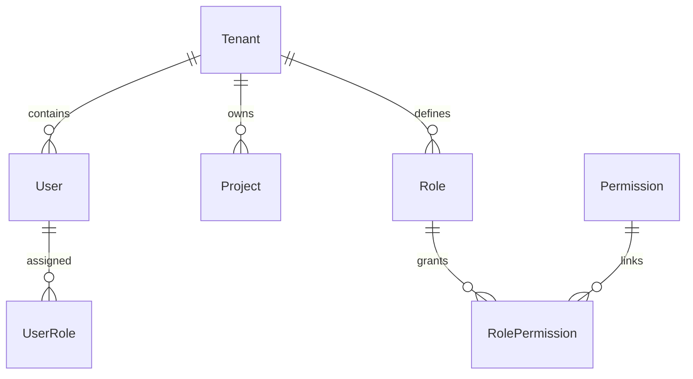
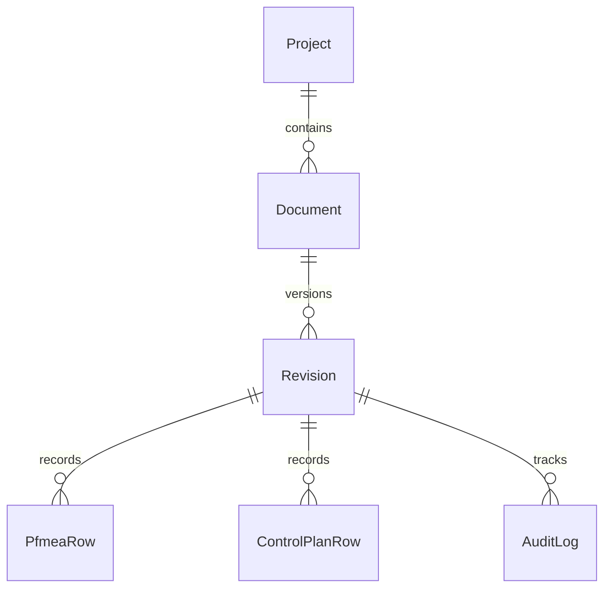
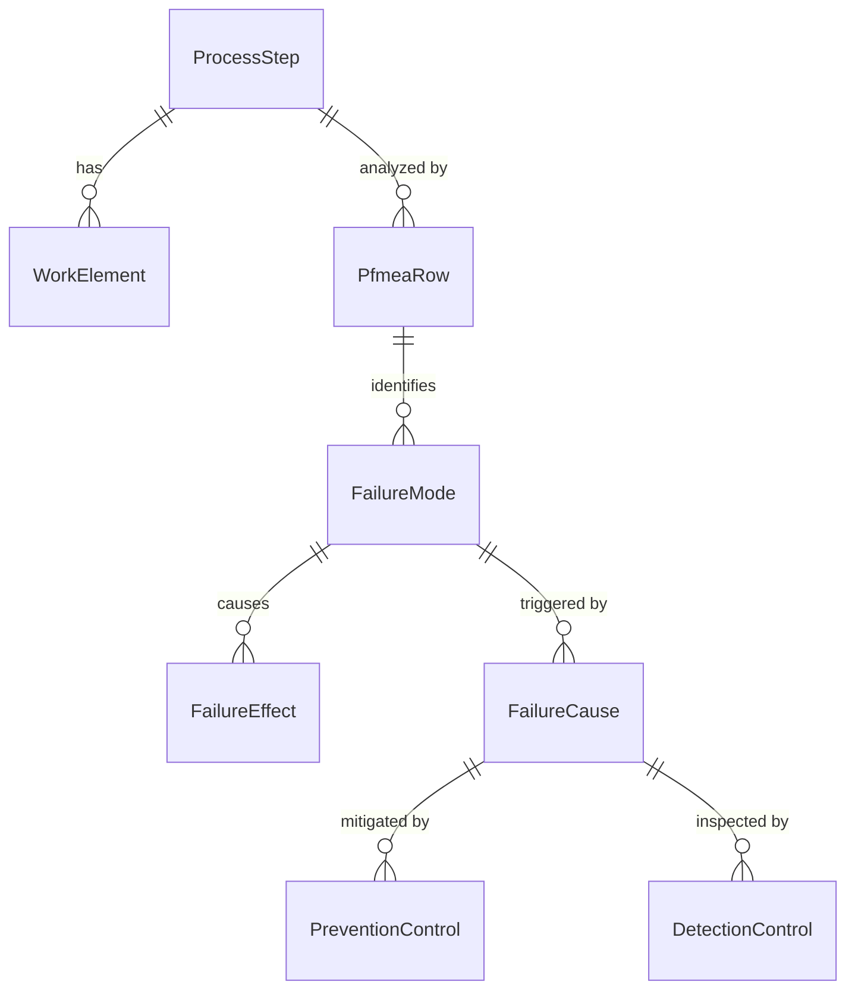
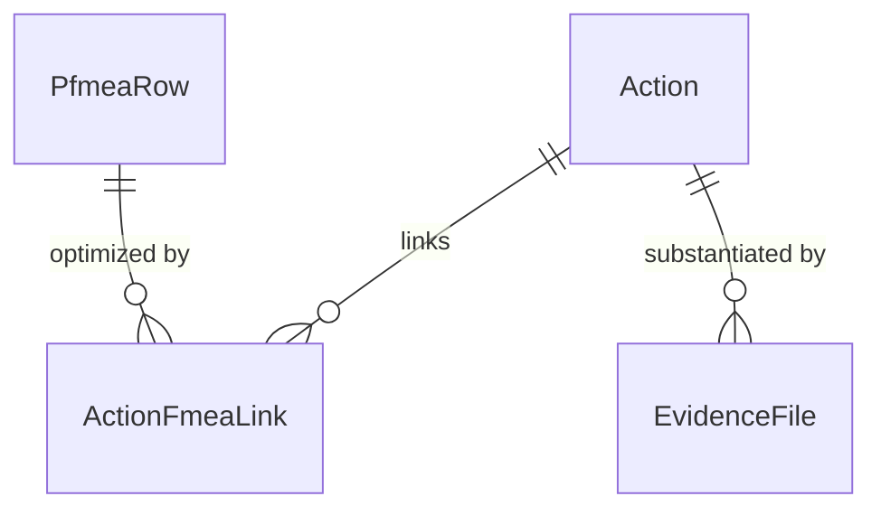

# Core Entity Relations & Data Schemas (`data_schemas.md`)

This specification defines the primary entity models, relationships, and transactional contracts implemented in the Prisma schema (`backend/prisma/schema.prisma`).

---

## 1. Multi-Tenant Foundation

- **`Tenant`**: Root boundary containing `id`, `slug`, `name`, `subdomain`, `createdAt`, `updatedAt`. All user-facing data tables link directly or transitively to `Tenant` with `ON DELETE CASCADE`.
- **`User`**: Account identity containing `id`, `email`, `passwordHash`, `tenantId`, `status`, `lastActivityAt`.
- **`Role` & `Permission`**: 5 core roles (`admin`, `quality_engineer`, `reviewer`, `approver`, `viewer`) mapped to granular permissions (`pfmea.create`, `pfmea.edit`, `revision.approve`, etc.).

---

## 2. Document & Revision Lifecycle (21 CFR Part 11)

- **`Document`**: FMEA document container (`DFMEA`, `PFMEA`, or `CP`).
- **`Revision`**: Versioned release state (`id`, `documentId`, `version`, `status`, `lockedAt`, `createdById`).
  - **Immutability Contract**: When `lockedAt != null`, any `UPDATE` or `DELETE` on linked rows is rejected at both the service layer and database trigger level.
  - **Segregation of Duties**: `createdById != reviewerId` and `createdById != approverId`.
- **`AuditLog`**: Immutable append-only log partition recording every revision status transition with cryptographic user identity, timestamp, and signature hash. Database constraints reject `UPDATE` and `DELETE`.

---

## 3. 7-Step FMEA Structural Tree & Risk Model

- **`ProcessStep`**: Step from Process Flow Diagram (`stepNumber`, `operationName`, `symbolType`, `classification`).
- **`WorkElement`**: 4M categorizations (Machine, Man, Material, Method).
- **`PfmeaRow`**: Core analysis row containing structural references, requirement definitions, and calculated `actionPriority` (`HIGH`, `MEDIUM`, `LOW`).
- **`FailureEffect`**: Downstream effect with `severity` [1..10].
- **`FailureCause`**: Root cause with `occurrence` [1..10].
- **`DetectionControl`**: Inspection mechanism with `detection` [1..10].

---

## 4. Control Plan (CP) Bidirectional Sync Contract

- **`ControlPlanRow`**: Corresponds to process steps and characteristics from the PFMEA.
- **Sync Transaction**:
  - Editing a control method, sample size, or reaction plan in `ControlPlanRow` automatically synchronizes back to the linked `DetectionControl` or `PreventionControl` in the PFMEA.
  - Updating a PFMEA characteristic tolerance propagates back to the linked `ControlPlanRow` in a serializable transaction.

---

## 5. Corrective Action Junction & Evidence Contract

- **`Action`**: Task entity tracking corrective/preventive optimization (`title`, `assigneeId`, `dueDate`, `status`).
  - State flow: `Open` $\rightarrow$ `InProgress` $\rightarrow$ `Completed` $\rightarrow$ `Verified` $\rightarrow$ `Closed` / `Cancelled`.
- **`ActionFmeaLink`**: Junction table recording before and after ratings:
  - Before: `beforeSeverity`, `beforeOccurrence`, `beforeDetection`, `beforeAp`.
  - After: `afterSeverity`, `afterOccurrence`, `afterDetection`, `afterAp`.
- **`EvidenceFile`**: Cloudflare R2 object reference (`fileUrl`, `fileSize`, `mimeType`, `uploadedById`). Verification and closure require at least one attached evidence file.
