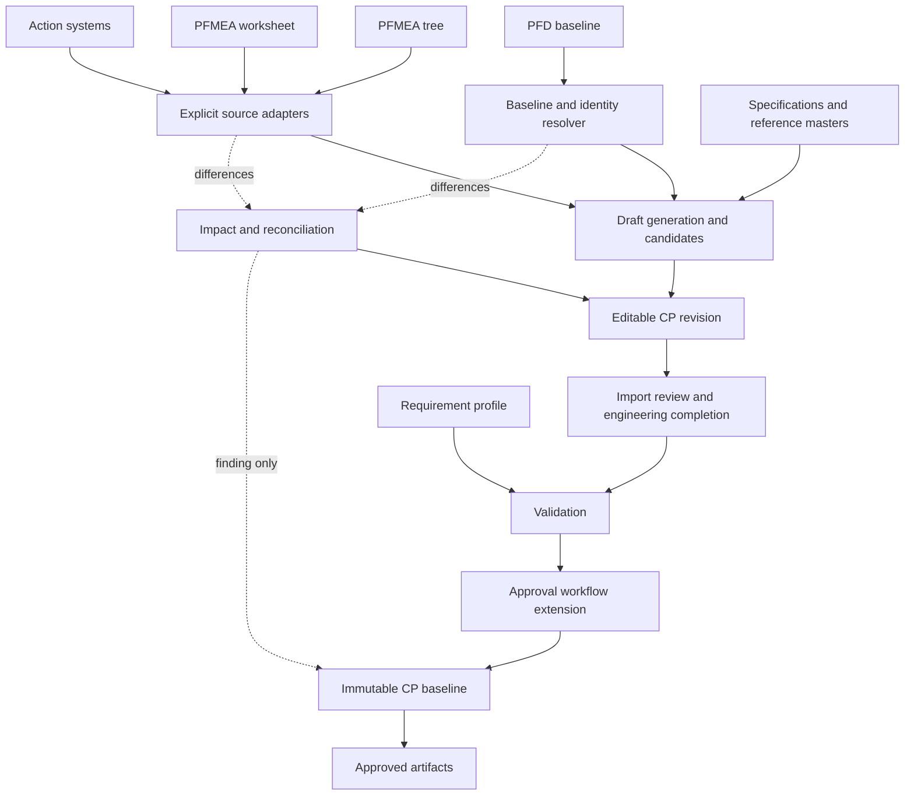
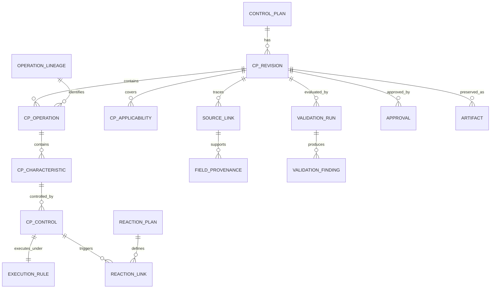

# Control Plan Module — Consolidated Development Plan

Document status: Development specification based on agreed requirements  
Scope: Integrate a dedicated Control Plan module into the existing PFD–PFMEA application  
Implementation approach: Inspect and extend the existing architecture; preserve current PFD and PFMEA functionality  
Standards status: Standards-informed design; licensed-publication and customer-applicability verification remains an explicit implementation gate

The module will provide an operation-wise Control Plan workspace, reviewed prefilling from upstream sources, field-level traceability, controlled change reconciliation, approval locking, and complete or selected-operation reporting.

The unresolved PFMEA report data source is an explicit development task—not an assumption and not a question the product owner needs to investigate.

---

## 1. Executive summary and implementation boundaries

### 1.1 Product objective

Create a CP module that allows an engineer to:

1. Select a product/project and source baselines.
2. Create a CP for a specified phase.
3. Generate an operation-wise draft.
4. Review relevant information imported from PFD and PFMEA.
5. Define characteristics, requirements, controls, measurement methods, execution rules and reactions.
6. Navigate directly to supporting source information.
7. Review upstream changes without silent overwriting.
8. Submit and approve a reproducible CP revision.
9. Export the complete plan or a compiled selection of operations.

### 1.2 Architectural constraints

The implementation must:

- Preserve existing PFD views and columns.
- Preserve PFMEA structure and report functionality.
- Reuse existing authentication, authorization, UI components, persistence conventions and approval guards where appropriate.
- Avoid requiring a full PFMEA model consolidation before CP implementation.
- Avoid treating the existing additive `Sync PFD` as a reconciliation service.
- Avoid assuming approved upstream revisions are complete immutable snapshots.
- Avoid inventing engineering values.
- Avoid introducing a “Released” status unless a separate release workflow is deliberately implemented.

### 1.3 Deliverable distinction

This document is the consolidated development plan, not the separate Antigravity execution prompt. Generate that prompt after the initial discovery tasks and architecture-specific adjustments are recorded.

## 2. Confirmed application baseline

| Area | Existing behavior |
|---|---|
| PFD equipment/documents | JSON lists of text entries |
| PFD desired outcome | Newline-separated text |
| PFD process characteristics | Newline-separated text |
| PFD operation UUID | New UUIDs created during cloning |
| Permanent operation lineage | Not implemented |
| PFMEA operation link | Nullable `linkedPfdStepId` |
| PFMEA cloning | Rows retain existing `processStepId` references |
| PFMEA `+ Step` | Adds an analysis row for an existing operation |
| Tree controls | Text fields on `StructureFailure`; no dedicated control ID |
| Worksheet controls | Separate UUID records connected through junction tables |
| Actions | Multiple models with different verification behavior |
| PFMEA report | Read-only combined-report tab |
| Linkage counter | Modes with at least one effect or cause; not complete-chain or PFD coverage |
| Approval | Decision and revision locking through `lockedAt` and backend guards |
| Active revision | Separate selection mechanism |
| Controlled release | Not implemented |
| Approved artifacts | Not automatically archived |
| `Sync PFD` | Additive import; not update/delete/split/merge reconciliation |

Evidence: supplied application screenshots and owner-provided implementation details. Screenshots establish visible UI, not backend behavior.

## 3. Standards and requirement governance

### 3.1 Reference baseline

- AIAG Control Plan, 1st Edition, 2024.
- AIAG APQP, 3rd Edition.
- AIAG–VDA FMEA Handbook, 1st Edition, 2019.
- IATF 16949:2016 with applicable sanctioned interpretations.
- Applicable OEM, customer and program requirements.

The AIAG Control Plan publication is separate from APQP and addresses Safe Launch, automated manufacturing and software-based management. See source register.

### 3.2 Mandatory task: requirement register

Create a versioned register before hardcoding compliance-related approval rules:

```text
Requirement ID
Classification: standard / handbook guidance / OEM / internal design
Publication and edition
Clause/page when verified
Applicability
Plain-language summary
Verification status
Software rule references
Reviewer and review date
```

Previously researched topics include special-characteristic cascade, automated-process references and revised general CP identification in the official IATF SI collection. Verify applicable editions before implementation.

### 3.3 Compliance boundary

Do not claim that expected columns establish compliance, imported controls establish effectiveness, automated validation replaces review, or software approval constitutes certification.

Display:

> Checks completed against requirement profile [version]. Engineering review and applicable approvals remain required.

Customer requirements must be versioned and scoped, not combined into universal rules.

## 4. P0 discovery and architecture-verification tasks

| ID | Task | Required output |
|---|---|---|
| DISC-01 | Inspect repository and architecture | Architecture map/module boundaries |
| DISC-02 | Trace PFMEA combined-report UI to query/service | Exact source model and transformation |
| DISC-03 | Trace tree/worksheet operation associations | Identity/reference diagram |
| DISC-04 | Inspect controls/actions retrieval | Source adapter contract |
| DISC-05 | Inspect revision cloning | Reference behavior/migration implications |
| DISC-06 | Inspect approval/locking | Reusable enforcement points |
| DISC-07 | Inspect active/effective revision behavior | Lifecycle semantics |
| DISC-08 | Inspect shared project entities | Snapshot/mutability boundaries |
| DISC-09 | Inspect reporting/export | Renderer/artifact-storage plan |
| DISC-10 | Inspect tenant/project/site authorization | Scope-enforcement plan |
| DISC-11 | Inspect UI components | Reuse inventory |
| DISC-12 | Verify licensed/customer requirements | Initial approved profile |

### DISC-02: combined-report investigation

1. Locate the PFMEA Report View component.
2. Trace its data loader, endpoint or service.
3. Identify whether each category comes from the tree, worksheet, action tracker or another transformation.
4. Identify source UUIDs retained or lost during rendering.
5. Identify operation grouping.
6. Identify cross-revision combination risks.
7. Document conflicts, duplicated representations and missing provenance.
8. Recommend the first supported CP source path.

Do not scrape report HTML or treat visible report text as the authoritative interface.

### Discovery gate

Document source ownership and revision scope before dependent integration coding. Full PFMEA consolidation is not required.

## 5. Agreed functional behavior

| ID | Requirement | Priority |
|---|---|---|
| CP-F01 | Open CP from project/product | P0 |
| CP-F02 | Open same CP operation from PFMEA | P0 |
| CP-F03 | One integrated CP revision with operation sections | P0 |
| CP-F04 | Show all relevant operation PFMEA context | P0 |
| CP-F05 | Prefill only relevant confirmed source information | P0 |
| CP-F06 | Highlight imported content until reviewed | P0 |
| CP-F07 | Confirm, edit-and-confirm, reject, view source | P0 |
| CP-F08 | Enter adds row at grid end | P0 |
| CP-F09 | Merge shared equipment across operation rows | P0 |
| CP-F10 | Multiple characteristics/controls per operation | P0 |
| CP-F11 | Highlight/center actual linked source | P0 |
| CP-F12 | Review source changes before application | P0 |
| CP-F13 | Complete and selected-operation reports | P0 |
| CP-F14 | Approved snapshots/artifacts | P0 |
| CP-F15 | Server-side approval locks | P0 |
| CP-F16 | Controlled successor revisions | P0 |

## 6. Information architecture and data flow

### 6.1 Source ownership

| Information | Owner |
|---|---|
| Intended sequence/process description | Selected PFD baseline |
| PFMEA functions/failures/risk | Supported explicit PFMEA path |
| Current controls | Originating record or failure field |
| Action status/evidence | Originating action system |
| Accepted CP arrangement | CP revision |
| Specifications | Applicable controlled reference/verified entry |
| Sampling/reactions | CP engineering with approved references |
| Approved content | Immutable CP snapshot |

### 6.2 Data flow



### 6.3 Adapter rules

Expose source model, source revision/scope, operation identity, functions/requirements, failure relationships, controls, actions/evidence, source locators and conflicts.

- No silent fallback between models.
- No text-based deduplication of engineering records.
- Unavailable data is not confirmed absence.
- Every adopted value retains its source path.
- MVP may support one verified path first.

## 7. Operation identity and revision mapping

```text
operationLineageId: logical operation across revisions
operationVersionId: concrete revision-owned operation
operationNumber: display identifier
sourceMapping: selected upstream-version relationship
```

Use an additive lineage/mapping layer where possible. Do not replace unrelated UUID references. Legacy matches may remain unresolved; number/name matching proposes candidates, not confirmed identity.

| Change | Handling |
|---|---|
| Rename/renumber | Preserve confirmed lineage; review display change |
| Reorder | Preserve identity; review sequence |
| Add | New candidate and coverage finding |
| Delete/orphan | Preserve history; disposition |
| Split | Explicit successor mapping; manual redistribution |
| Merge | Explicit mapping; resolve duplicates/conflicts |
| Reused number | Do not assume continuity |

For null/incompatible `linkedPfdStepId`: show mismatch, preserve draft work, offer resolution, do not silently alter PFMEA, and block approval when required mapping remains unresolved.

## 8. Source-to-CP mapping

### 8.1 PFD

| Source | Destination/use | Rule |
|---|---|---|
| UUID | Source reference | Retain with baseline mapping |
| Number/description | Operation display | Prefill; review |
| Equipment list | Shared resources/references | Import and classify |
| Desired outcome | Requirement context/candidates | No automatic approval |
| Process-characteristic text | Characteristic/criterion candidates | Preserve and review |
| Variation sources | Context | Not acceptance criteria |
| Special class | Classification candidate | Assign to characteristic |
| Flow symbols | Process context | Do not create extra operations |
| Drawing/WI text | Reference candidate | Resolve identity/version |

### 8.2 PFMEA

| Source | Destination/use | Rule |
|---|---|---|
| Operation relationship | Operation association | Identity resolution |
| Function | Context/characteristic suggestion | Engineer confirmation |
| Failure mode | Risk context | Not positive characteristic |
| Effect | Risk/escalation context | Usually excluded from main CP |
| Cause | Parameter/control context | Not automatically characteristic |
| Current prevention | Control candidate | Confirm execution/implementation |
| Current detection | Evaluation/control candidate | Complete criteria and method |
| S/O/D/AP | Review context | Never automatic sampling formula |
| Recommended action | Proposed task/control | Not active control |
| Completed action | Evidence candidate | Verification separate |
| Verified evidence | Support | Confirm CP applicability |
| Special classification | Candidate | Govern scheme/source |

### 8.3 Tree control provenance

```text
sourceModel = TREE
sourceEntity = StructureFailure
sourceEntityId = UUID
sourceField = prevention/detection field
capturedValue = original text
capturedContext = source snapshot
```

Do not manufacture permanent control identity from text hashes. Worksheet controls retain actual UUIDs and junction references.

## 9. CP field dictionary and manual completion

Requiredness is the proposed application profile—not a claim of universal standard mandates. R = required; C = conditional.

| Field | Meaning | Status | Population/validation |
|---|---|---|---|
| CP number | Document identity | R | Scope-unique |
| Revision | Baseline | R | Existing conventions |
| Product/site/customer | Applicability | R | Authorized scope |
| Part/design revision | Requirement baseline | R/C | Applicable reference |
| Phase | Prototype/pre-launch/production | R | Explicit |
| Safe Launch | Additional launch configuration | C | Separate from phase |
| Requirement profile | Applicable rules | R | Approved version |
| Source baselines | PFD/PFMEA scope | R | Compatibility resolver |
| Operation identity | Stable relationship | R | No label-only matching |
| Shared equipment | Manufacturing resources | C | Classified entries |
| Characteristic number | Display reference | R | Separate internal ID |
| Characteristic type | Product/process | R | Explicit |
| Description | Positive feature/parameter | R | Clear meaning |
| Criteria | Accepted condition | R where applicable | Verified value/reference |
| Unit | Measurement unit | C | Compatible |
| Special class | Governed designation | C | Scheme/applicability |
| Method | Executable evaluation/control | R/C | Detail/reference |
| Measurement equipment | Gauge/sensor/tester | C | Specific reference |
| Sampling mode | Coverage model | C | Typed mode |
| Quantity | Count | C | Mode-dependent |
| Frequency/trigger | Timing | R for active control | Explicit |
| Coverage | Lane/cavity/fixture/variant | C | Complete scope |
| Reaction trigger | Abnormal condition | R for active control | Matches output |
| Reaction action | Response | R for active control | Executable |
| Containment | Suspect scope | C | Verified decision |
| Responsibility | Owner/function | R | Valid role |
| Restart criteria | Resumption | C | Authority/evidence |
| Record reference | Results location | C | Accessible |
| Implementation evidence | Active-control support | R/C | Scope/verification |
| Provenance | Import history | R for imports | Preserved |
| Review state | CP acceptance | R | Separate approval |

Never invent tolerances, limits, operating windows, sampling, measurement suitability, reactions, containment, restart conditions, classifications or Safe Launch exit criteria. Libraries provide candidates requiring applicability review.

## 10. Prefill, normalization and confirmation

| State | Meaning | Presentation |
|---|---|---|
| Imported/unreviewed | Explicit source value | Light-blue and label |
| Accepted | Reviewed applicability | Normal; source indicator |
| Modified/accepted | Changed from source | Modified indicator |
| Rejected | Not adopted | Decision history |
| Suggestion | Interpretation | Separate treatment |
| Source change pending | Upstream difference | Amber warning |
| Required input | Missing needed value | Missing indicator |

Colour is supplementary. Actions: Confirm, Edit and confirm, Reject, View source, Review selected fields, Review operation. Bulk review shows exact accepted fields.

Safe normalization: whitespace and established presentation. No silent instruction rewrites, numeric reinterpretation, tolerance changes, ambiguous unit conversion or engineering splitting into approved records.

Review is tied to field content. Edits invalidate affected acceptance; upstream changes trigger review, not replacement.

## 11. UX and pages

| Page | Purpose |
|---|---|
| CP list | Revisions/phase/scope/status |
| Creation wizard | Applicability/sources |
| Import preview | Candidates |
| Structure workspace | Operation editing |
| Report View | Read-only preview |
| Change review | Three-way comparison |
| Approval | Package/decision |
| Artifact/history | Preserved outputs/audit |

```text
Shared header
CP revision | phase | actual status | freshness
Operation navigator | Shared machine/fixture/tools
                    | Collapsible PFMEA context
                    | CP grid
                    | Detail drawer / validation
```

Show all relevant operation context, group analysis, provide focused navigation and preserve overview. Reuse current UI patterns.

Source selection resolves actual records, expands groups, centers/highlights exact information and preserves CP keyboard focus. Multiple sources remain explicit; manual entries have no invented source.

## 12. Grid behavior and row semantics

Manufacturing resources are operation-level and visually merged; measurement equipment is control-specific.

- Enter commits/moves down; at last row it appends draft row.
- Add Row remains visible.
- Multiline line-break behavior is distinct.
- Empty rows are not approved content.

```text
Operation
  Characteristic
    Control application
      Method
      Equipment
      Execution rule
      Reaction
      Evidence
```

Provide Add characteristic, Add control, Duplicate as draft, Delete with dependency review and permitted reordering. Duplication does not copy review confirmation or imply evidence applicability.

## 13. End-to-end workflow

### First creation

1. Open scope.
2. Select phase/profile.
3. Select source baselines.
4. Resolve model/identity issues.
5. Preview coverage.
6. Generate draft.
7. Review resources.
8. Review characteristic candidates.
9. Define controls/execution.
10. Complete criteria/measurement/reaction.
11. Review evidence/actions.
12. Validate.
13. Preview.
14. Submit.
15. Approve/archive.

Working sources can support drafts; source approval requirements must be explicit.

### Update

Detect differences, show affected content, compare, decide, apply only to editable revisions, create successor for locked CP, revalidate and reapprove.

## 14. Database and versioning

| Entity | Purpose |
|---|---|
| ControlPlan | Stable document; many revisions |
| ControlPlanRevision | Lifecycle/scope/phase/baselines |
| CPApplicability | Product/site/line/variant |
| CPOperation | Revision-owned snapshot |
| OperationLineage/Mapping | Cross-revision identity |
| CPCharacteristic | Feature/criteria/classification |
| CPControlApplication | Method/execution/equipment |
| CPSamplingRule | Typed coverage/execution |
| CPReactionPlan | Response/reference |
| CPSourceLink | Exact source locator |
| CPFieldProvenance | Captured/current values/decisions |
| CPImplementationEvidence | Verification basis |
| CPReviewDecision | Field/operation review |
| CPValidationRun/Finding | Content-bound results |
| CPChangeImpact | Differences/resolution |
| CPApproval | Existing workflow integration |
| CPArtifact | Archived output |
| CPAuditEvent | Append-only history |
| RequirementProfileRevision | Rules/sources |



Enforce tenant/project scope, immutable approvals, content-bound reviews/validation, no silent retargeting, versioned libraries and historical snapshots surviving source deletion. Fit the existing persistence stack.

## 15. Change propagation and action verification

Compare previous imported value, new source value and current CP value. Decisions: accept, retain with reason, manually edit, not applicable, defer.

Preserve:

```text
sourceSystem
sourceStatus
implementationReported
verificationState
verificationBasis
evidenceReferences
cpApplicabilityReview
```

Tracker verification and tree completion are not equivalent. Missing proof means verification not established, not ineffective.

P0 comparisons: source selection, CP opening/reconciliation, and mandatory pre-approval freshness check. Event-driven alerts depend on existing infrastructure; do not assume real-time events for shared entities.

## 16. Validation engine

Categories: blocking, engineering warning/disposition, information; customer applicability is a separate dimension.

| Rule | Outcome |
|---|---|
| Missing scope/phase/profile | Block |
| Invalid/cross-project link | Block |
| Unresolved required mapping | Block |
| Omitted applicable operation | Review/block by profile |
| Required import unreviewed | Block approval |
| Missing applicable criterion/method | Block |
| Invalid count-based quantity | Block |
| Missing trigger/coverage | Block where applicable |
| Missing reaction/responsibility | Block by profile |
| Proposed action counted active | Block |
| Relied-upon verification absent | Review/block by dependency |
| Conflicting source models | Block affected adoption |
| Source changed after review | Re-review |
| Required customer approval absent | Block |
| Approved content mismatch | Reject |
| Artifact incomplete | Package failure |

```text
prepareApproval(cpRevision):
    assertAuthorized()
    assertEditable()
    resolveSourceScope()
    findings = validate(cpRevision, requirementProfile)
    if unresolvedBlockingFindings(findings): reject()
    baseline = captureConsistentSnapshot(cpRevision)
    if sourceChangedSinceReview(baseline): requireImpactReview()
    artifact = renderAndArchive(baseline)
    if artifactFailed:
        recordPackageFailure()
        rejectCompletion()
    finalizeApprovalUsingExistingWorkflow(baseline, validationRun, artifact)
```

Fit transaction/jobs to the architecture. Never silently omit snapshot/artifact steps.

## 17. Reporting

Two scopes: complete CP and selected-operation compiled extract, from the same revision.

Extracts preserve identifiers/order/status, list included operations, state they are extracts and do not create revisions.

Header: organization/site, customer/product/part, CP number/revision/phase/status, issue/revision identification, applicability, responsibility and source/profile references.

| Operation | Shared equipment | Characteristic | Special class | Criteria | Evaluation | Sample/trigger | Control | Reaction | Owner |
|---|---|---|---|---|---|---|---|---|---|

Repeat headers and continuation identities; repeat equipment where needed; avoid truncation; reference long controlled details; include legends; mark drafts; preserve rendering version.

P0 outputs: PDF, spreadsheet through suitable existing infrastructure, structured snapshot/manifest. Preserve row/control IDs and avoid Cartesian duplication. Archive full approved PDF; generate other formats from the frozen snapshot.

## 18. Security, permissions and audit

| Role | Permissions |
|---|---|
| Viewer | Authorized content/artifacts |
| Engineer | Draft/edit/source review |
| Reviewer | Technical review/dispositions |
| Approver | Existing authorized approval |
| Requirement administrator | Profiles/templates |
| System administrator | Technical administration, not automatic engineering authority |

Server-side scope/locks, concurrency protection, content-bound approval, append-only audit, override reasons, artifact authorization, scoped jobs, approved AI data handling and separate source acceptance/review/approval are required safeguards.

## 19. MVP priorities, tests and gates

### Priorities

| Phase | Scope |
|---|---|
| P0 | Discovery, adapter, identity mapping, snapshots, editor, prefill review, navigation, validation, reconciliation, approval, artifacts, report scopes |
| P1 | More adapters, libraries, customer templates, imports, richer comparison, master integration |
| P2 | MES/SPC/PLC, AI suggestions, multi-plant libraries, dedicated release |

Full PFMEA unification is not prerequisite.

### Essential tests

- Repeat imports without duplicates.
- Renumbering retains identity.
- Clone UUID changes trigger mapping.
- Null linkage is explicit.
- Multiple analysis rows remain one CP operation.
- List reorder does not retarget resources.
- Compound text remains reviewable.
- Same wording retains distinct provenance.
- Model conflicts are visible.
- Proposed actions do not become active.
- Tree completion is not tracker verification.
- Reconciliation preserves local edits.
- Locked revisions reject API/job changes.
- Approved reports survive source edits/deletion.
- Concurrent approval changes are detected.
- Extracts are labelled.
- Long reports paginate properly.
- Cross-tenant references fail.
- Artifact failures cannot masquerade as completed packages.
- Existing PFD/PFMEA regressions pass.

### Gates

| Gate | Evidence |
|---|---|
| G1 | Discovery complete and source selected |
| G2 | Model/lineage/snapshot design approved |
| G3 | Draft generation/edit/review demonstrated |
| G4 | Reconciliation/locking tested |
| G5 | Approval artifacts/report scopes verified |
| G6 | Authorization/migration/regression/profile verification passed |

### Implementation handover

Architecture summary, verified mappings, migrations/rollback considerations, component/service inventory, validation catalogue, tests, limitations, requirement verification, sample outputs and user documentation.

## Final implementation direction

Select operation → review PFMEA context → edit CP rows with shared manufacturing equipment → confirm imports → reconcile explicitly → approve/preserve exact document → export all or selected operations.

DISC-02 formally covers report-source investigation. Do not replace it with assumptions or redesign unrelated modules.

## Source register

These links preserve the public references used in the preceding research; they do not replace licensed-publication verification or imply that every design requirement is a standards mandate.

- AIAG Control Plan CP-1: https://www.aiag.org/training-and-resources/manuals/details/CP-1
- AIAG APQP-3: https://www.aiag.org/training-and-resources/manuals/details/APQP-3
- IATF sanctioned interpretations index: https://www.iatfglobaloversight.org/iatf-169492016/iatf-169492016-sis/
- IATF November 2025 SI collection: https://www.iatfglobaloversight.org/wp/wp-content/uploads/2025/11/IATF-16949-SIs-Nov-2025.pdf
- Customer requirements index: https://www.iatfglobaloversight.org/oem-requirements/customer-specific-requirements/
- Ford June 2026 SCCAF CSR: https://www.iatfglobaloversight.org/wp/wp-content/uploads/2026/06/Ford-IATF-CSR_Jun-2026-SCCAF_Final.pdf
- GM October 2025 CSR: https://www.iatfglobaloversight.org/wp/wp-content/uploads/2025/10/IATF-16949-GM-Customer-Specific-Requirements-October-2025.pdf
- Project evidence: supplied 2019 AIAG–VDA handbook, FMEA Executive screenshot, four application screenshots, and owner-confirmed implementation details.
