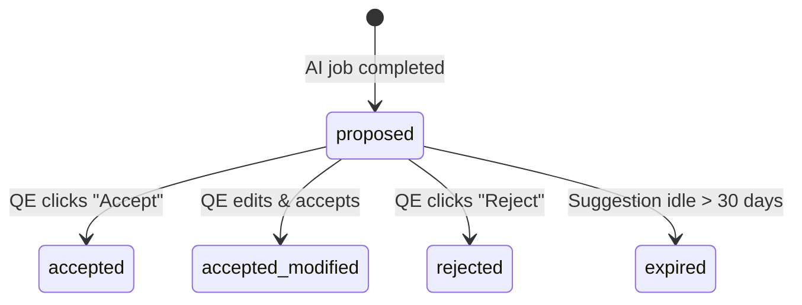

# Workflow: AI Suggestion Review Lifecycle (Human-in-the-Loop)

This document defines the review mechanics, validation gates, and application flow of AI-proposed suggestions.

---

## 1. Suggestion Lifecycle States

1. **Proposal**: Suggestions generated by AI models are saved as `proposed` in the `ai_suggestion` table.
2. **Reviewing**: Suggestions appear in the FMEA workspace sidebar panel.
3. **Application**:
   - **Accept**: System copies proposed values directly to active FMEA row; status becomes `accepted`.
   - **Edit & Accept**: QE modifies suggestion cells on form and applies; status becomes `accepted_modified`.
   - **Reject**: User rejects suggestion; status becomes `rejected` and the rejection reason is logged.
   - **Expire**: Cron jobs run daily to flag proposed suggestions older than 30 days as `expired`.

---

## 2. Technical Scope

- **Impacted Database Tables**: `ai_suggestion`, `ai_suggestion_reference`, `pfmea_row`, `dfmea_row`.
- **Involved Roles & Permissions**: `Quality Engineer` with permission `ai.use`.
- **AI Agents**:
  - **Agent 7: Safety & Compliance Guardrail Agent** (runs verification interceptors).

## 3. Validation Rules & Edge Cases
- **No Direct Writing**: AI suggestions never alter live document records directly; they require human action.
- **Confidence Gate**: Suggestions with confidence scores under 0.3 are automatically flagged in the UI with warning indicators.
- **Traceability**: Every suggestion logs `created_by_model` (tracking model type, version, and prompt context).
- **Agent 7 Safety Guardrail Rules**:
  - *Safety Severity*: If a failure mode links to safety-critical consequences, the suggested Severity rating must be suggested as ≥ 8.
  - *Ratings Bounds*: suggested ratings must strictly reside in [1, 10].
  - *AP Table Matching*: suggested S/O/D ratings must match official Action Priority lookup tables.
  - *Control Separation*: Prevention controls and detection controls must be categorized separately.
  - *No Hallucinations*: suggested options must map to valid system reference records.
- **Locked Revision**: If the target document revision is locked, suggestions are blocked from being accepted or applied.

---

## 4. Related Workflows
- `vector-indexing.md`: The RAG search pipeline supplies candidate suggestions.
- `fmea-authoring.md`: Suggestions are displayed and accepted within the FMEA workspace.
