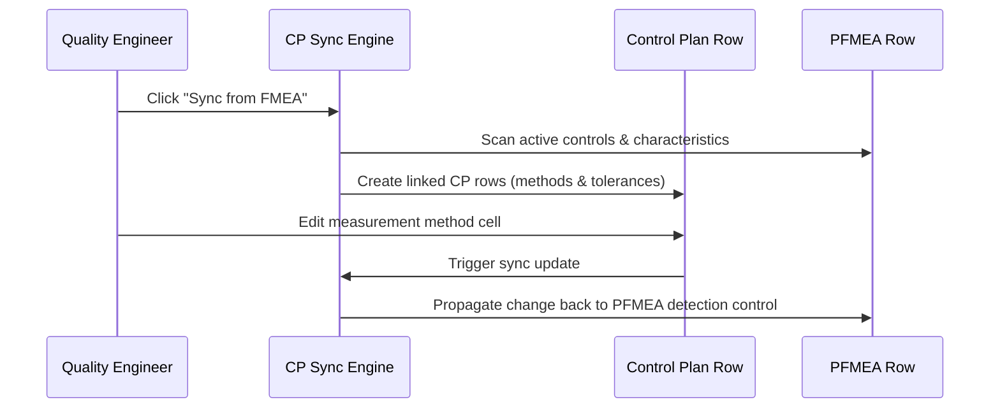

# Workflow: Control Plan Generation & Bidirectional Sync

This document describes the auto-generation and bidirectional update workflow of manufacturing Control Plans linked to Process FMEAs.

---

## 1. Sequence of Steps

1. **Trigger**: Quality engineer triggers Control Plan generation or sync.
2. **Scan & Extract**: The sync engine queries the active `document_revision` rows. For each `pfmea_row`:
   - For each associated `control` (prevention or detection):
     - For each linked `characteristic`:
       - Create or update `control_plan_row` mapping `process_step_id`, `characteristic_id`, and `control_type`.
       - Map the detection control to `measurement_method` and the characteristic specifications to `spec_tolerance`.
       - Seed defaults for `sample_size`, `frequency`, and `reaction_plan` from standard templates.
       - Log link in the `control_plan_pfmea_link` junction table.

---

## 2. Technical Scope

- **Impacted Database Tables**: `control_plan_row`, `control_plan_pfmea_link`, `pfmea_row`, `control`, `characteristic`.
- **Involved Roles & Permissions**: `Quality Engineer` with permissions `cp.edit`.
- **AI Agents**:
  - **Agent 4: Consistency & Coverage Checker** (verifies all critical characteristics map to a control and react plans are defined).

## 3. Bidirectional Sync Rules & Edge Cases
- **Simultaneous Updates**: When a cell is modified in the Control Plan grid, database hooks run in a serializable transaction to update the corresponding cell in the PFMEA row, and vice-versa.
- **Deletions**: If an FMEA control is deleted, the sync engine flags the corresponding CP row as orphaned (Warning: `Control plan row has missing FMEA source mapping`) rather than silent deletion, allowing user review.
- **Locked Document Protection**: If the `document_revision` has `locked_at` set, all sync mutations are blocked, and API requests return `403 Forbidden`.
- **Collision Handling**: If two fields are updated concurrently, the system uses optimistic locking on the document revision record.

---

## 4. Related Workflows
- `fmea-authoring.md`: FMEA rows supply characteristics and controls.
- `pfd-pfmea-linking.md`: Process steps sequence maps PFD to CP.
- `revision-approval.md`: Locking revisions blocks all subsequent CP updates.
