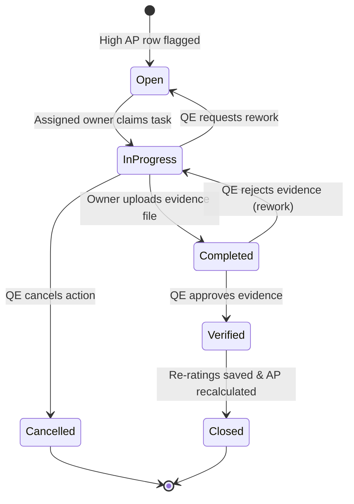

# Workflow: Corrective Actions Optimization & Tracking Lifecycle

This document defines the lifecycle states, evidence verification loops, and risk re-rating procedures for corrective action items.

---

## 1. Action Lifecycle

1. **Trigger**: An FMEA row has AP calculated as High (H). An action item is mandated.
2. **Assign**: Owner is selected and status set to `Open`.
3. **Execution**: Owner works on the mitigation and updates status to `InProgress`.
4. **Evidence Upload**: Owner completes the work, types notes, and uploads verification documents (PDFs, images) directly to Cloudflare R2. Status becomes `Completed`.
5. **Verification**: QE validates evidence. If verification fails, the state reverts to `InProgress`. If verification succeeds, status becomes `Verified`.
6. **Approval & Re-rating**: QE assigns post-action (After) Severity, Occurrence, and Detection ratings. The system recalculates AP. Status becomes `Closed`.
7. **Cancellation**: If the engineering design is modified to remove the source failure mode, the QE can transition the action to `Cancelled`.

---

## 2. Technical Scope

- **Impacted Database Tables**: `action`, `action_evidence`, `action_fmea_link`, `pfmea_row`, `dfmea_row`.
- **Involved Roles & Permissions**:
  - `Quality Engineer`: Permissions `action.create`, `action.close`.
  - `Action Owner` (User): Permissions `action.edit`, `action.view`.
- **AI Agents**:
  - **Agent 6: Action & Optimization Agent** (suggests corrective actions and predicts ratings).

## 3. Validation Rules & Edge Cases
- **Action Type Classification**: Every action must be defined as either `corrective`, `preventive`, or `improvement`.
- **Evidence Mandate**: Transition to `Completed` is rejected by NestJS validators unless an upload file is provided. Maximum file size is 50MB.
- **Ratings Re-evaluation**: Post-action ratings are required upon closure. AP is recalculated automatically.
- **Sync Back**: The new ratings are transactionally synced back to the source FMEA row.
- **Locked Revision**: Actions linked to locked document revisions cannot be modified, and status changes are rejected.
- **Overdue Alerts**: Chron jobs run daily to flag actions past their `due_date` and trigger socket alerts.

---

## 4. Related Workflows
- `fmea-authoring.md`: High AP row flags trigger action creation requirements.
- `revision-approval.md`: Revisions cannot be submitted for approval if they contain uncompleted actions.
