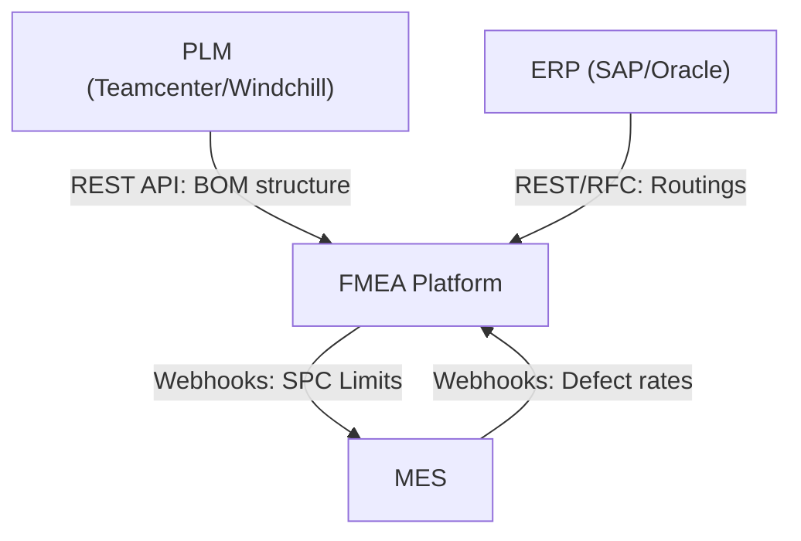

# Workflow: PLM / ERP / MES Integrations Data Sync

This document describes the synchronization loops, security measures, and webhook flows mapping external engineering data into the FMEA platform.

---

## 1. Sync Sequences

### 1.1 Capability & Protocol Matrix
- **PLM Systems (Siemens Teamcenter, PTC Windchill)**:
  - *BOM Import*: Import assemblies, sub-assemblies, and specifications using REST APIs to seed the starting DFMEA tree.
  - *Characteristics Sync*: Bidirectional synchronization of Special/Critical characteristics using OIDC-authenticated Webhooks.
  - *Analysis Export*: Export finalized DFMEA worksheets back to PLM.
- **ERP Systems (SAP, Oracle)**:
  - *Part Master*: Pull part names and numbers using REST/RFC.
  - *Process Routing*: Sync production routing sequences to automatically generate steps on the PFD canvas.
  - *Export Limits*: Push quality inspection limits.
- **MES Systems**:
  - *SPC Limits*: Push SPC tolerances, sample sizes, frequencies, and reaction plans (REST/OPC-UA).
  - *Quality Defect Loop*: MES posts actual defect statistics. The system checks Occurrence (O) ratings and flags rows if defect rates exceed current ratings.

---

## 2. Technical Scope

- **Impacted Database Tables**: `project`, `document`, `process_step`, `characteristic`, `trace_link`.
- **Involved Roles & Permissions**: `Admin` or `System Integrator` with permission `admin.config`.
- **AI Agents**:
  - **Agent 4: Consistency & Coverage Checker** (runs validation checks after data imports).

## 3. Webhook Security & Event Specifications
- **HMAC Signatures**: Outbound webhook requests carry HMAC-SHA256 signatures in the `X-FMEA-Signature` header, signed using a tenant-specific shared secret.
- **Webhook Events List**:
  - `fmea.revision.approved`
  - `fmea.row.created`
  - `fmea.row.updated`
  - `action.created`
  - `action.closed`
  - `control_plan.updated`
- **Inbound Webhook Verification**: Inbound calls are subjected to tenant token authorization check.
- **Import Idempotency**: All imports use idempotency keys to prevent duplicate record insertion during network retries.

---

## 4. Related Workflows
- `pfd-pfmea-linking.md`: ERP process step routings automatically feed the PFD steps canvas.
- `fmea-authoring.md`: PLM BOM import seeds the initial structural hierarchies.
- `corrective-actions.md`: MES closed-loop defect statistics verify the effectiveness of corrective actions.
