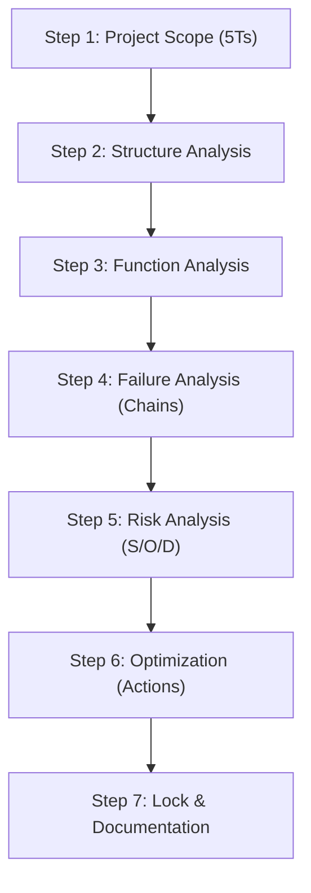

# Workflow: FMEA Authoring & The 7-Step Process

This document describes the operational flow, roles, database modifications, and validation policies governing Design and Process FMEA authoring.

---

## 1. Sequence of Steps

### 1.1 Step-Gating Entry Criteria Table
| Step | Process Step | Required Input / Entry Criteria | Output Produced |
|---|---|---|---|
| 1 | Planning (5Ts) | Project charter & scope boundaries | Document scope & 5T items |
| 2 | Structure Analysis | BOM structure (DFMEA) or PFD routing (PFMEA) | Parent-child structural tree nodes |
| 3 | Function Analysis | Structure tree nodes and design specs | mmapped functions and tolerances |
| 4 | Failure Analysis | Functions and requirements | Complete failure chains (Cause → FM → Effect) |
| 5 | Risk Analysis | Completed failure chains | S/O/D ratings and calculated AP |
| 6 | Optimization | High AP lines identified | Assigned mitigation actions |
| 7 | Documentation | Optimizations verified | Approved & locked revision |

### 1.2 DFMEA & PFMEA Structural Flows
- **DFMEA Flow**: P-Diagram inputs (signals, noise, environments) → System → Subsystem → Component. Identifies Special/Critical Characteristics which must flow down to the PFMEA.
- **PFMEA Flow**: PFD routing steps → Process Item → Process Step → Work Element (4Ms: Man, Machine, Material, Environment).

---

## 2. Technical Scope

- **Impacted Database Tables**: `project`, `document`, `document_revision`, `process_step`, `work_element`, `function`, `requirement`, `failure_mode`, `effect`, `cause`, `control`, `characteristic`, `pfmea_row`, `dfmea_row`.
- **Involved Roles & Permissions**: `Quality Engineer` with permissions `pfmea.create`, `pfmea.edit`, `dfmea.create`, `dfmea.edit`.
- **AI Agents**:
  - **Agent 1: PFMEA Draft Generator** (generates rows from PFD steps).
  - **Agent 2: DFMEA Structure Agent** (models P-diagram trees).
  - **Agent 3: Rating Recommender** (recommends S/O/D ratings).

## 3. Validation Rules & Edge Cases
- **Failure Chain Completeness**: Every failure mode must have at least one effect and one cause. Each cause must link to at least one prevention or detection control.
- **Ratings Gating**: S/O/D ratings must be integers strictly within [1, 10].
- **Severity Inheritance**: The FMEA row Severity is automatically set to the maximum Severity rating of all its linked failure effects.
- **AP Read-Only**: The AP (Action Priority) lookup is locked. AP table configuration must exist in the database or the transaction aborts.
- **Step Gating Violations**: If a user attempts to edit Step N before Step N-1 is populated, NestJS gates reject the request with `400 Bad Request`.
- **Null S/O/D Ratings**: Rows with null S/O/D values are excluded from AP lookup and flag validation warnings.

---

## 4. Related Workflows
- `pfd-pfmea-linking.md`: PFD steps map to PFMEA row structures.
- `control-plan-sync.md`: Source of characteristics and controls.
- `ai-suggestion-review.md`: Suggestion review panel lifecycle.
- `corrective-actions.md`: High AP rows mandate corrective actions.
- `revision-approval.md`: Final submission and locking process.
