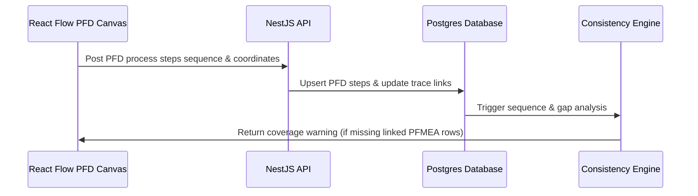

# Workflow: PFD ↔ PFMEA Bidirectional Linking & Gap Analysis

This document outlines how Process Flow Diagrams (PFD) and Process FMEAs (PFMEA) remain synchronized, and how the gap analysis engine validates process coverage.

---

## 1. Sequence of Steps

1. **PFD Definition**: User creates steps, sequences, and layout coordinates on the React Flow canvas (mapping to `position_x`, `position_y` and `graphical_data` JSONB columns in `pfd_step`).
2. **PFMEA Mapping**: Every `pfmea_row` is bound to a process step ID using `pfmea_row.process_step_id`.
3. **Consistency Audit**: The background audit engine checks that FMEA coverage matches the diagram.

---

## 2. Technical Scope

- **Impacted Database Tables**: `process_step`, `pfd_step`, `pfmea_row`, `trace_link`.
- **Involved Roles & Permissions**: `Quality Engineer` with permissions `pfd.edit`, `pfmea.edit`.
- **AI Agents**:
  - **Agent 4: Consistency & Coverage Checker** (scans for unmapped sequences).

## 3. Gap Check Rules & Edge Cases
- **Auditing Check Types**:
  - *Critical Error*: A PFMEA row cannot map to a process step ID that does not exist in the PFD.
  - *Warning*: A PFD step that has no corresponding PFMEA row generates a coverage warning: `Process step '{step_number}' has zero FMEA mappings`.
  - *Warning*: Sequence order mismatch between PFD step sequences and PFMEA grid rows.
  - *Critical Error*: Special characteristics defined in the DFMEA must have corresponding coverage in the PFMEA.
- **PFD Step Deletion**: When a step is deleted from the PFD, the database enforces cascade deletions of linked FMEA rows, prompting a UI confirmation modal: `Deleting this step will delete all associated FMEA analysis rows. Continue?`.
- **Concurrent Editing**: Optimistic lock version checking on `document_revision` resolves collision conflicts if two engineers edit the PFD and FMEA grid simultaneously.

---

## 4. Related Workflows
- `fmea-authoring.md`: FMEA step authoring feeds off the structure.
- `control-plan-sync.md`: Syncs controls and tolerances down to the Control Plan.
