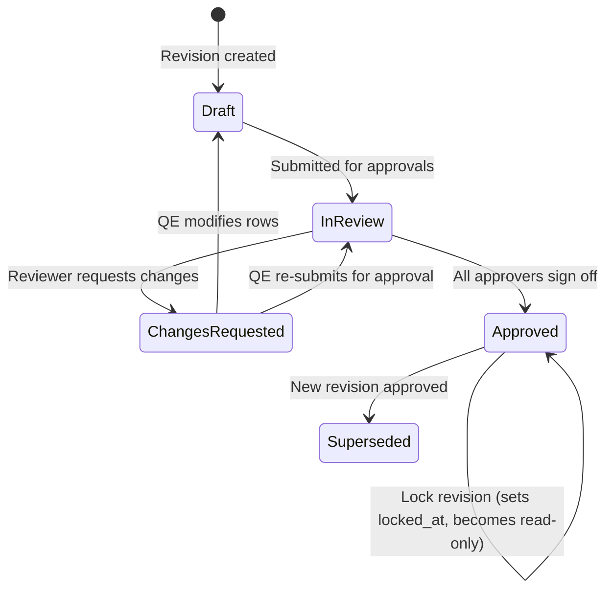

# Workflow: Document Revision Submission, Review, and Approval

This document defines the states, review constraints, and immutable locking process for FMEA document revisions.

---

## 1. Revision Lifecycle States

1. **Drafting**: QE makes edits to PFD/FMEA/CP rows.
2. **Review Request**: Revision state updated to `InReview`. Modifications to FMEA rows are blocked.
3. **Approvals**: Designated reviewers evaluate the draft.
   - If change requested: State changes to `ChangesRequested` and returns to `Draft` for rework. Can be re-submitted (`ChangesRequested` → `InReview`).
   - If approved: Approvers submit their digital signatures. State changes to `Approved`.
4. **Locking**: Approved revisions are locked (setting `locked_at` timestamp), making the records entirely read-only.
5. **Supersede**: Once a new draft revision is approved, the older approved revision is marked `Superseded`.

---

## 2. Technical Scope

- **Impacted Database Tables**: `document`, `document_revision`, `approval`, `audit_log`.
- **Involved Roles & Permissions**:
  - `Quality Engineer` (Author): Permissions `revision.create`, `revision.submit`.
  - `Reviewer`: Permission `revision.review`.
  - `Approver`: Permission `revision.approve`.
- **AI Agents**:
  - **Agent 4: Consistency & Coverage Checker** (runs validation checks before submission).
- **Validation Rules**:
  - **Segregation of Duties**: The author of the revision cannot act as its reviewer or approver.
  - **Configuration**: Requires a minimum of 1 reviewer and 1 approver (configurable per tenant).
  - **21 CFR Part 11**: Approval records must capture user name, timestamp, digital signature verification hash, and decision comment.
  - **Audit Logs**: All state transitions must write to the partitioned `audit_log` database table (enforcing the UPDATE/DELETE immutability rule).

---

## 3. Related Workflows
- `fmea-authoring.md`: FMEA Step 7 results in revision submissions.
- `vector-indexing.md`: Transition to `Approved` triggers the async embedding indexing pipeline.
