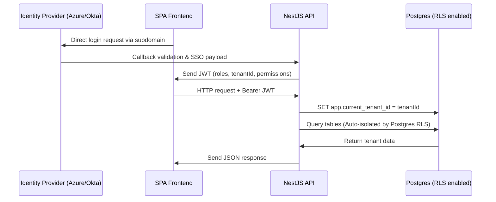

# Workflow: SSO Authentication & Tenant Context Verification Flow

This document details the single sign-on authentication process, user domain mapping, and database connection context isolation.

---

## 1. Authentication & Query Sequence



### 1.1 Authentication Mechanics
1. **SSO Authentication Flow**:
   - Uses **OAuth 2.0 / OpenID Connect (OIDC)** with **Authorization Code Flow with PKCE** (Proof Key for Code Exchange).
   - Supported Identity Providers (IDPs): **Azure AD (Entra ID)**, **Okta**, and **Google Workspace**.
2. **Local Authentication Fallback**:
   - Users can authenticate locally via email/password.
   - Passwords must be hashed using **bcrypt with cost factor 12**.
3. **MFA Verification**:
   - If `mfa_enabled` is set on the user entity, the client must verify a one-time passcode (TOTP) before receiving access tokens.

---

## 2. Technical Scope

- **Impacted Database Tables**: `tenant`, `user`, `role`, `user_role`, `role_permission`.
- **Involved Roles & Permissions**: All roles.
- **JWT Token Payload Structure**:
  ```json
  {
    "sub": "user_123456",
    "email": "engineer@tenant-domain.com",
    "tenant_id": "tenant_abc987",
    "roles": ["Quality Engineer"],
    "permissions": ["pfmea.create", "pfmea.edit"],
    "iat": 1718000000,
    "exp": 1718000900
  }
  ```

## 3. Validation Rules & Tenant Isolation
- **Row-Level Security (RLS)**: The database runs pg-connection variables whitelisting. NestJS request interceptors extract `tenant_id` from Bearer JWT and run `SET app.current_tenant_id = {tenantId}` and `SET app.current_user_id = {userId}` before transaction execution.
- **CORS Domain Whitelist**: Only whitelisted subdomains matching `*.proj-fmea.com` or tenant domains can perform OIDC callbacks.
- **Cascading Deletes**: To prevent orphan or cross-tenant data leaks, all tables have foreign keys bound with `ON DELETE CASCADE` referencing the `tenant` table.
- **JWT Expiration**: Access tokens expire in 15 minutes. Refresh tokens expire in 7 days with rotation.

---

## 4. Related Workflows
- Auth is a core prerequisite and applies to all other workflows:
  - `fmea-authoring.md`: Verifies role and tenant bounds before saving rows.
  - `revision-approval.md`: Segregates creator and approver roles using the JWT user payload.
