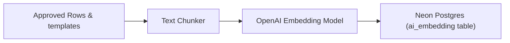
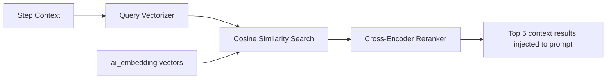

# Workflow: AI Vector Embedding Indexing & Querying Pipeline (RAG)

This document describes the indexing of approved FMEAs into high-performance vector representations and the RAG-based query pipeline.

---

## 1. Pipeline Flows

### 1.1 Indexing Pipeline (Async)

1. **Trigger**: Status transitioned to `Approved`.
2. **Queueing**: Pushes an indexing task to the BullMQ `embedding` queue (low priority, 600s timeout, 2 retries).
3. **Chunking**: The chunker processes entity structures:
   - *PFMEA Row*: Concatenates: `Function Name + Failure Mode + Effect + Root Cause + Prevention Controls + Detection Controls`.
   - *DFMEA Row*: Concatenates: `Component Name + Function Name + Failure Mode + Effect + Root Cause`.
   - *Templates / Knowledge Items*: Each row/item forms a single chunk.
4. **Vectorization**: Request embeddings via OpenAI `text-embedding-3-small` API (1536 float elements).
5. **Storage**: Save to the `ai_embedding` table alongside metadata tags (`process_type`, `industry`, `material`, `severity`).

### 1.2 Query Pipeline (Real-Time)

1. **Context Vectorization**: User drafts FMEA nodes; front-end requests proposals, sending context text.
2. **Neon Search**: Convert input to query vector, execute Cosine Similarity lookup to return top-k=10 records.
3. **Reranking**: Feed top-k=10 candidates to a Cross-Encoder model to output the top 5 most relevant results.
4. **Generation**: Inject top 5 matches into the system prompt as historical context references and invoke LLM.

---

## 2. Technical Scope

- **Impacted Database Tables**: `ai_embedding`, `ai_suggestion`.
- **Involved Roles & Permissions**: `Quality Engineer` with permission `ai.use`.
- **AI Agents**: All suggestion-generating agents.

## 3. Validation Rules & Edge Cases
- **Strict Tenant Isolation**: All queries must filter on `tenant_id = current_tenant_id` to prevent cross-tenant exposure.
- **HNSW Parameters**: Neon HNSW index on the vector column uses settings: M=16, ef_construction=64.
- **API Failures**: If OpenAI or the cross-encoder is down, the queue retries up to 2 times, then logs a failure to `audit_log` without crashing the transaction.
- **Tenant Cleanup**: Deleting a tenant cascades to remove all linked `ai_embedding` records.

---

## 4. Related Workflows
- `revision-approval.md`: Approving a revision triggers the indexing pipeline.
- `ai-suggestion-review.md`: Similarity search results feed suggestion proposals.
